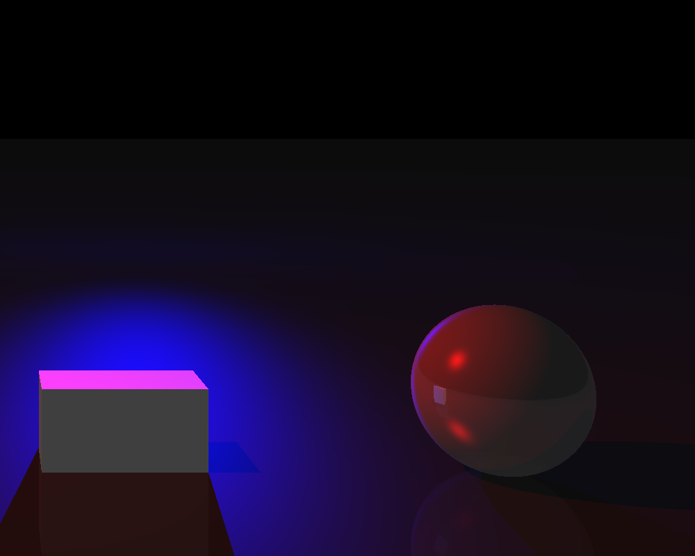

## Guide 

### install (linux)
#### need: 
- opencv
- pkg-config 
```
sudo apt install libopencv-dev pkg-config
```
- nlohman-json (für input)
```
sudo apt install nlohmann-json3-dev
```
- doxygen for documentation
https://www.doxygen.nl/manual/install.html
- we worked with git submodules (for Eigen): 
```
git submodule init 
git submodule update
```
the starting point for all following commands is ./project/
### Compile
executable can be found in build/main 
- compile the programm 
```
make
```

- compile and run the program
```
make run 
```

- compile and run the tests 
```
make test
```

### input 
main file will read /json/cur.json 

### documentation
The Doxyfile can be found as ./project/Doxyfile 
- to update documentation 
```
doxygen Doxyfile
```
documentation is found in ./project/docs/doxy/html with index.html as starting point

### result
the result with provided cur.json should look like this:
