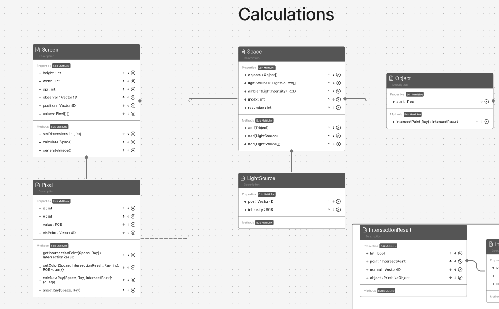
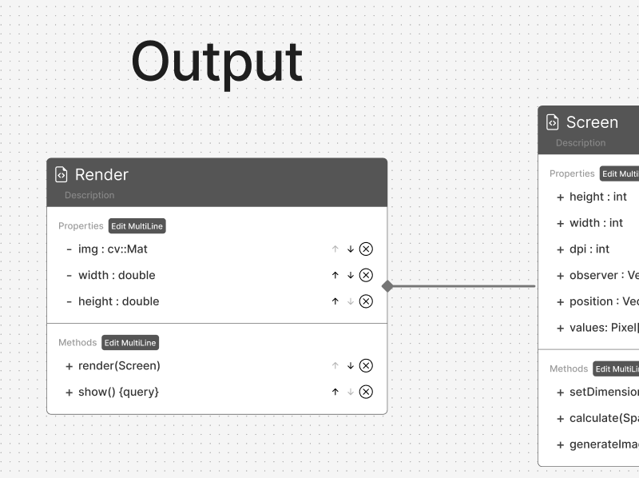
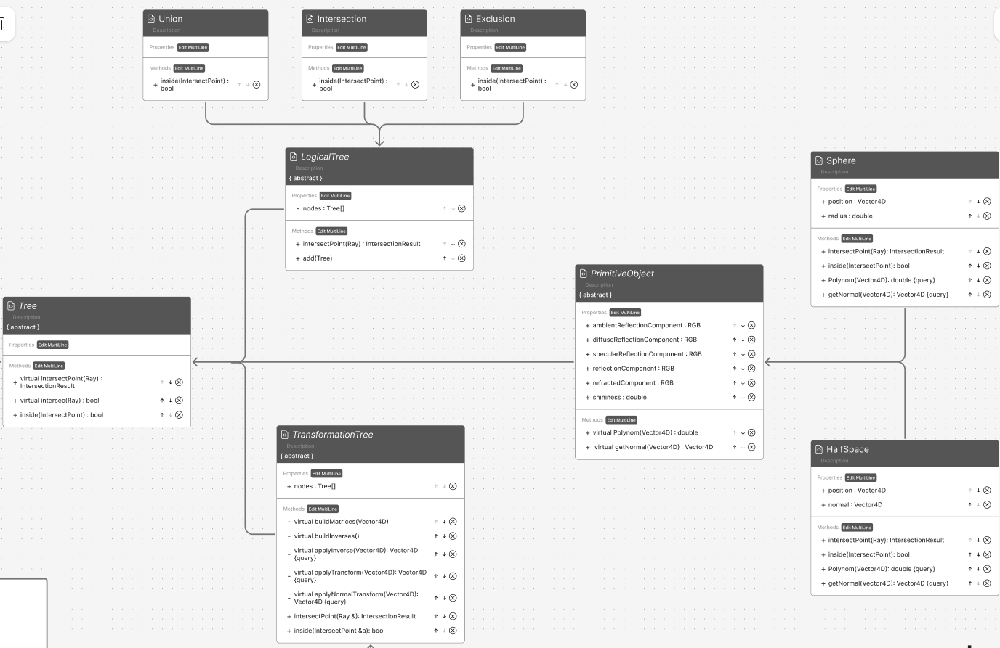
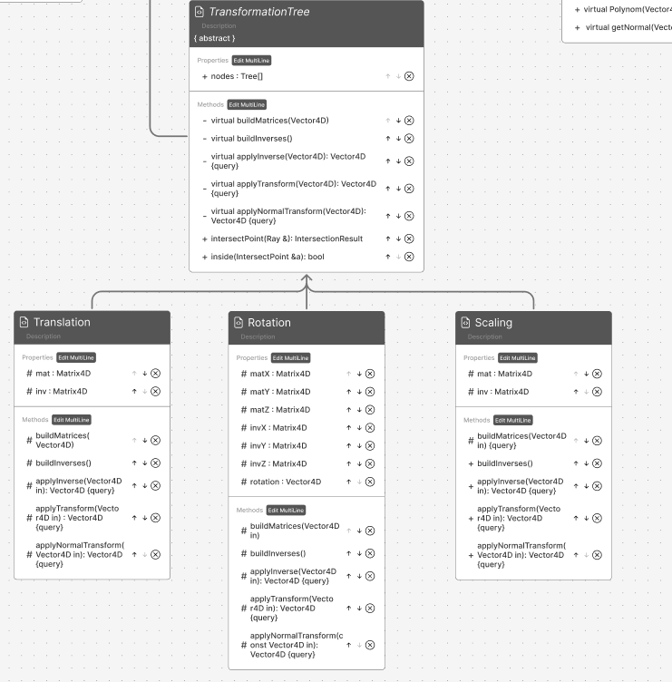
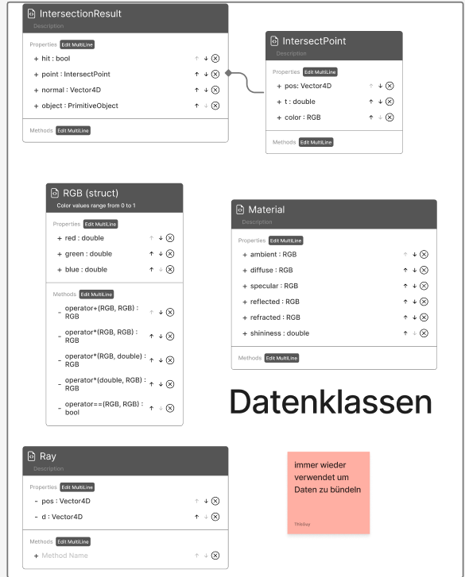

## UML Diagramm
since of the size of our UML-diagramm we had to split it. in the Readme of our group 
### Calculation

### Output

### Scene creation

### Data Classes

## Description of Program Algorithm

**V0.1:**
- Read input files
- Build screen and scene trees
- Shoot rays through each pixel
    - Calculate intersection points and choose correct one using scalar values
    - Return color of intersection point to pixel
- Convert pixel values to output file
- Convert output file to image using OpenCV

## Development Plan

### Implementation of the screen with ambient component only  

Goal: Distinction between Halfspace and "Skybox" (printed out as values)
Test: Correct calculations of each function

- Basic headers
- Halfspaces, i.e. basic chain of Tree/ObjectTree/PrimitiveObject classes 
- Screen/Pixels
- Ambient light component $E_a$ 
    - $ E_a ​=K_a \cdot ​I_a ,$
- Shadows

### File IO

Goal: Fully convert output text to image using OpenCV
Test: Working parsing with sample json file (manual) + visual confirmation

- JSON Parsing (include json library?)
- Output in an image file 
- OpenCV

### Implementation of Logical Trees 

Goal: Presentable objects that are combined using logical operations
Test: Correct intersection points

- Union
- Intersection
- Exclusion
- also Spheres

### Implementation of Transformation Trees 

Test: Correct intersection points

- Translation
- Rotation
- Scaling

### Addition of Diffuse, Specular compenents

Test: Light values

- ~~Ambient light component $E_a$~~
    - $ E_a ​=K_a \cdot ​I_a$
- Diffuse component $E_d$
    - $E_d ​= K_c \cdot ​I_L​ (\vec{V} \ast \vec{N})$
- Specular component $E_s$
    - $E_s ​= K_s \cdot ​I_L​ (\vec{R} \ast \vec{V})^α$

### Addition of Reflected and refracted components

Test: Light values, recursion depth

- Reflected component
    - $E_r ​= K_r​ ​\cdot I_r​$
- Refracted component
    - $Et ​= K_t ​\cdot I_t​$

- Combination of all components
    - $E = E_a ​⊕ \underset{\text{lightsources}}{∑}​(E_d​(\text{source}) ⊕ E_s​(\text{source})) ⊕ E_r ​⊕ E_t​$
